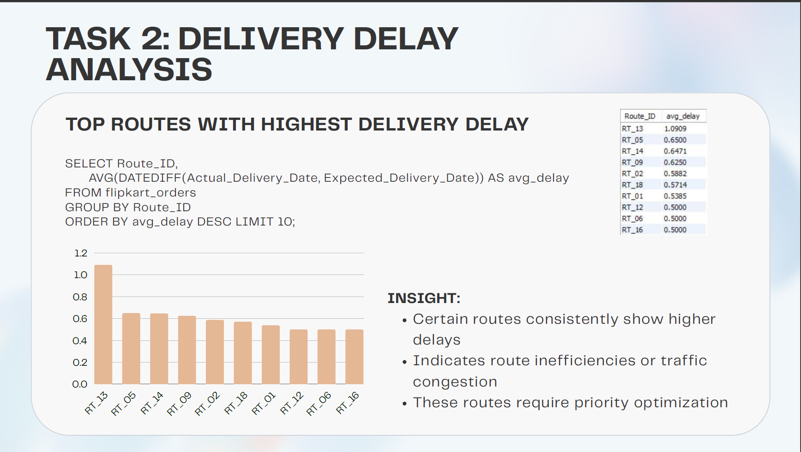
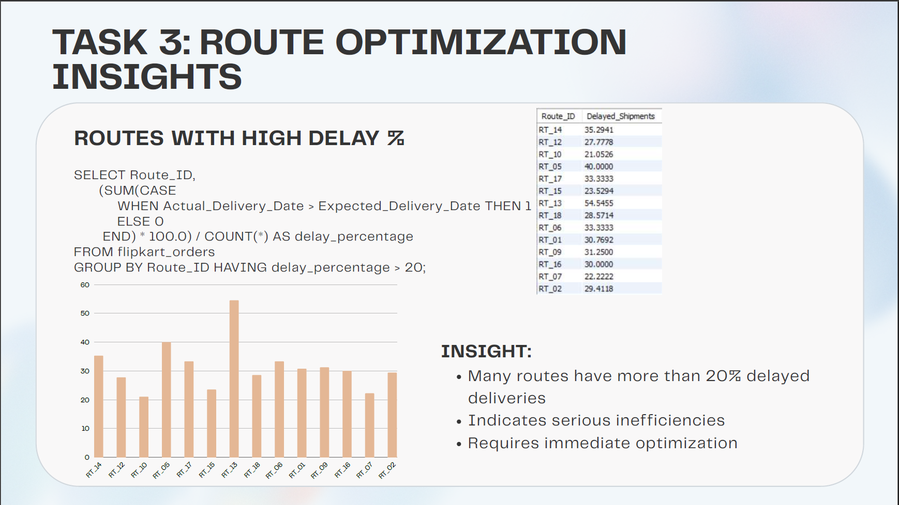
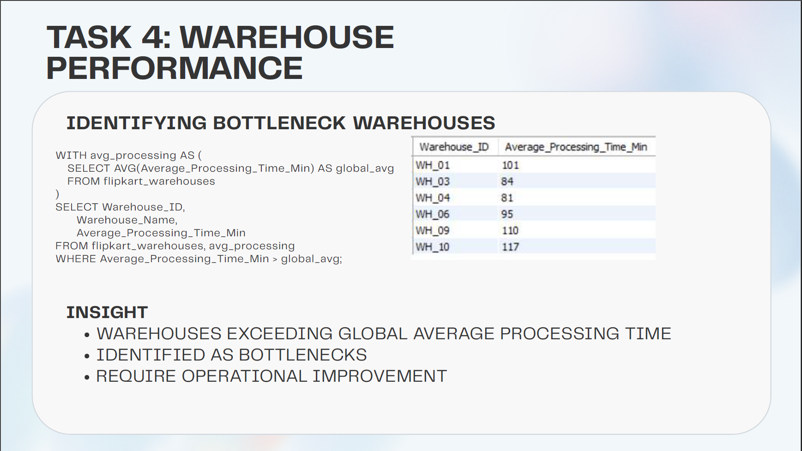

# 🚚 Logistics Optimization for Delivery Routes – Flipkart


## 📌 Project Overview

This project focuses on optimizing Flipkart's logistics and delivery operations using SQL-based data analysis. By examining delivery routes, warehouse performance, shipment tracking, and delivery agent efficiency, the project identifies operational bottlenecks and provides actionable recommendations to improve delivery speed and overall logistics performance.

The analysis was completed using MySQL by writing complex SQL queries involving joins, aggregations, Common Table Expressions (CTEs), window functions, ranking functions, and conditional logic.

---

## 🎯 Project Objectives

- Clean and validate logistics datasets
- Analyze delivery delays across routes
- Identify inefficient delivery routes
- Evaluate warehouse performance
- Analyze delivery agent performance
- Monitor shipment tracking status
- Generate logistics KPIs
- Recommend optimization strategies

---

# 🛠️ Tools & Technologies

- **MySQL**
- **SQL**
- **MySQL Workbench**
- **Microsoft PowerPoint**
- **Microsoft Excel**

---

# 📂 Repository Structure

```
Logistics-Optimization-for-Delivery-Routes-Flipkart
│
├── datasets
│   ├── Flipkart_DeliveryAgents.csv
│   ├── Flipkart_Orders.csv
│   ├── Flipkart_Routes.csv
│   ├── Flipkart_ShipmentTracking.csv
│   └── Flipkart_Warehouses.csv
│
├── presentation
│   └── Logistics_Optimization_for_Delivery_Routes_Flipkart.pdf
│
├── screenshots
│   ├── 01_data_cleaning.png
│   ├── 02_delivery_delay_distribution.png
│   ├── 03_top_delayed_routes.png
│   ├── 04_route_performance_metrics.png
│   ├── 05_high_delay_routes.png
│   ├── 06_warehouse_performance.png
│   ├── 07_bottleneck_warehouses.png
│   ├── 08_delivery_agent_performance.png
│   ├── 09_shipment_tracking.png
│   └── 10_conclusions.png
│
├── sql
│   └── Flipkart_Logistics_Optimization.sql
│
├── LICENSE
└── README.md
```

---

# 📊 Dataset

The project uses five datasets:

- Orders
- Routes
- Warehouses
- Delivery Agents
- Shipment Tracking

These datasets simulate Flipkart's logistics network and delivery operations.

---

# 📈 Project Workflow

### ✅ Task 1 — Data Cleaning & Preparation

- Verified primary keys
- Removed duplicate records
- Checked missing values
- Standardized date formats
- Validated delivery dates


---

### 🚚 Task 2 — Delivery Delay Analysis

Performed delay analysis to identify:

- Delivery delay distribution
- Most delayed routes
- Warehouse-wise delivery delays




---

### 🛣️ Task 3 — Route Optimization

Analyzed:

- Route efficiency
- Average delivery time
- Traffic delays
- High-delay routes




---

### 🏢 Task 4 — Warehouse Performance

Evaluated:

- Total shipments
- Delayed shipments
- Warehouse bottlenecks
- Processing efficiency




---

### 👨‍💼 Task 5 — Delivery Agent Performance

Compared delivery agents using:

- On-time delivery percentage
- Performance ranking
- Speed comparison


---

### 📦 Task 6 — Shipment Tracking

Analyzed shipment status throughout the delivery lifecycle.


---

### 💡 Final Business Recommendations

Key recommendations include:

- Optimize low-efficiency delivery routes
- Reduce traffic-related delays
- Improve warehouse processing times
- Enhance delivery planning strategies
- Address warehouse bottlenecks


---

# 📊 Key Insights

- Most deliveries are completed on time.
- Certain routes consistently experience higher delays.
- Warehouse bottlenecks significantly affect delivery performance.
- Route efficiency is strongly influenced by traffic congestion.
- Delivery agent performance varies, but route and traffic conditions have a major impact.
- Shipment tracking data helps identify operational inefficiencies and improve customer satisfaction.

---

# 🎥 Project Walkthrough

## Part 1

👉 https://www.loom.com/share/519a939ef711457d970e77f466b2729b

## Part 2

👉 https://www.loom.com/share/2bce798c27254d4db2faf6ce44ddacb4

---

# 💼 Skills Demonstrated

- SQL
- MySQL
- Database Design
- Data Cleaning
- Data Validation
- Joins
- Aggregate Functions
- Window Functions
- Common Table Expressions (CTEs)
- Ranking Functions
- Business Analytics
- Logistics Analytics
- KPI Reporting
- Data Visualization
- Problem Solving

---

# 👨‍💻 Author

**Sujal Agrahari**

Aspiring Data Analyst | Data Science & AI Enthusiast

---

# 🙏 Acknowledgement

This project was completed as part of the **Internshala Data Science Training Program** to develop practical SQL skills through a real-world logistics optimization case study.

---

⭐ If you found this project interesting, consider giving it a **Star**!