# 🚚 Logistics Optimization for Delivery Routes – Flipkart

[](https://www.mysql.com/)
[](https://www.python.org/)
[](https://sqlite.org/)
[](https://docs.pytest.org/)
[](https://github.com/Sujal0973/Logistics-Optimization-for-Delivery-Routes-Flipkart)
[](https://github.com/Sujal0973/Logistics-Optimization-for-Delivery-Routes-Flipkart)

---

## 📌 Executive Summary

This end-to-end data analytics and supply chain optimization project analyzes simulated logistics operations for **Flipkart**, one of India's largest e-commerce marketplaces. 

By analyzing **delivery routes, warehouse throughput, shipment tracking checkpoints, and delivery agent performance**, this project identifies critical operational bottlenecks, isolates delay root causes, and provides data-driven strategies to improve delivery turnaround times and on-time fulfillment rates.

## 📑 Evaluation Rubric & Submission Breakdown (100 Marks)

This project strictly adheres to the official evaluation criteria and task deliverables:

| Task # | Module / Deliverable | Evaluated Concepts | Maximum Marks | Deliverable Artifact |
| :---: | :--- | :--- | :---: | :--- |
| **Task 1** | **Data Cleaning & Preparation** | PK Duplicates, Null Imputation, `STR_TO_DATE()`, Delivery Date Logic | **10 Marks** | [`sql/Flipkart_Logistics_Optimization.sql`](sql/Flipkart_Logistics_Optimization.sql) |
| **Task 2** | **Delivery Delay Analysis** | `DATEDIFF()`, Aggregations, Window Ranking (`RANK() OVER`) | **10 Marks** | [`sql/Flipkart_Logistics_Optimization.sql`](sql/Flipkart_Logistics_Optimization.sql) |
| **Task 3** | **Route Optimization Insights** | Transit Speed, Efficiency Ratio, SLA Filtering (`HAVING > 20%`) | **20 Marks** | [`sql/Flipkart_Logistics_Optimization.sql`](sql/Flipkart_Logistics_Optimization.sql) |
| **Task 4** | **Warehouse Performance** | Hub Latency, Common Table Expressions (`WITH CTE`), On-Time Ranking | **10 Marks** | [`sql/Flipkart_Logistics_Optimization.sql`](sql/Flipkart_Logistics_Optimization.sql) |
| **Task 5** | **Delivery Agent Performance** | Driver Route Ranking, `<80%` On-Time Filtering, **Subqueries Cohort Speed** | **10 Marks** | [`sql/Flipkart_Logistics_Optimization.sql`](sql/Flipkart_Logistics_Optimization.sql) |
| **Task 6** | **Shipment Tracking Analytics** | Latest Scan Timestamps, Root Cause Frequencies, Multi-Delay Scans | **10 Marks** | [`sql/Flipkart_Logistics_Optimization.sql`](sql/Flipkart_Logistics_Optimization.sql) |
| **Task 7** | **Advanced KPI Reporting** | Regional Aggregations, Network On-Time Rate %, Route Traffic Delays | **10 Marks** | [`sql/Flipkart_Logistics_Optimization.sql`](sql/Flipkart_Logistics_Optimization.sql) |
| **Task 8** | **PowerPoint Presentation** | Cleanly formatted queries, result tables, high-resolution charts | **10 Marks** | [`presentation/Flipkart_Logistics_Optimization.pptx`](presentation/Flipkart_Logistics_Optimization.pptx) |
| **Task 9** | **Video Walkthrough** | 5-9 min project understanding, analysis walkthrough, and drive link | **10 Marks** | [Loom Presentation Video](https://www.loom.com/share/519a939ef711457d970e77f466b2729b) |
| **Total** | **Comprehensive Logistics Analytics** | **Full SQL + Business Intelligence System** | **100 Marks** | [`Flipkart_Logistics_Optimization_Submission.zip`](Flipkart_Logistics_Optimization_Submission.zip) |

---

## 📑 Table of Contents

- [Executive Summary](#-executive-summary)
- [Key Performance Indicators (KPI Scorecard)](#-key-performance-indicators-kpi-scorecard)
- [Entity-Relationship Architecture (ERD)](#-entity-relationship-architecture-erd)
- [Dataset Dictionary](#-dataset-dictionary)
- [Repository Structure](#-repository-structure)
- [Quickstart & Reproduction Guide](#-quickstart--reproduction-guide)
- [Task-by-Task Analytical Breakdown](#-task-by-task-analytical-breakdown)
  - [Task 1: Data Cleaning & Integrity](#-task-1-data-cleaning--integrity-validation)
  - [Task 2: Delivery Delay Distribution](#-task-2-delivery-delay-analysis)
  - [Task 3: Route Transit Efficiency](#-task-3-route-optimization-insights)
  - [Task 4: Warehouse Throughput & Bottlenecks](#-task-4-warehouse-performance--bottleneck-detection)
  - [Task 5: Delivery Agent Performance & Cohorts](#-task-5-delivery-agent-performance)
  - [Task 6: Shipment Tracking & In-Transit Diagnostics](#-task-6-shipment-tracking-analytics)
  - [Task 7: Advanced KPI Reporting & Regional Insights](#-task-7-advanced-kpi-reporting)
- [Strategic Business Recommendations](#-strategic-business-recommendations)
- [Walkthrough Video Presentations](#-walkthrough-video-presentations)
- [Technical Skills Demonstrated](#-technical-skills-demonstrated)
- [Author & Acknowledgements](#-author--acknowledgements)

---

## 🎯 Key Performance Indicators (KPI Scorecard)

The following metrics summarize the core findings derived across 300 orders and 1,000 shipment tracking records:

| Metric Category | Operational KPI | Observed Value | Industry Benchmark / Target | Status |
| :--- | :--- | :---: | :---: | :---: |
| **Fulfillment Reliability** | On-Time Delivery Rate | **72.67%** (218 / 300) | $\ge 90.00\%$ | ⚠️ Below Target |
| **Delivery Delays** | Delayed Deliveries Rate | **27.33%** (82 / 300) | $\le 10.00\%$ | ⚠️ Bottleneck |
| **Average Delay** | Mean Delay (All Orders) | **0.45 Days** (~10.8 hrs) | $\le 0.2$ Days | ℹ️ Operational Buffer |
| **Delay Severity** | Mean Delay (When Late) | **1.66 Days** (~39.8 hrs) | $\le 1.0$ Days | ❌ High Impact |
| **Speed to Customer** | Average Turnaround Time | **4.51 Days** | $\le 3.5$ Days | ℹ️ Inter-state Transit |
| **Revenue Handled** | Total Order Value | **₹7,619,897.98** INR | — | 300 Orders Analyzed |
| **Order Economics** | Average Order Value (AOV) | **₹25,399.66** INR | — | High-value Electronics |
| **Warehouse Processing** | Global Average Hub Time | **79.40 Minutes** | $\le 60.0$ Minutes | 6 Warehouses Exceed |
| **Primary Delay Cause** | Traffic In-Transit Share | **56.41%** (387 incidents) | — | Major Route Hurdle |

---

## 🏛️ Entity-Relationship Architecture (ERD)

The relational schema links warehouses, transit routes, delivery agents, end-to-end orders, and multi-stage tracking checkpoints:

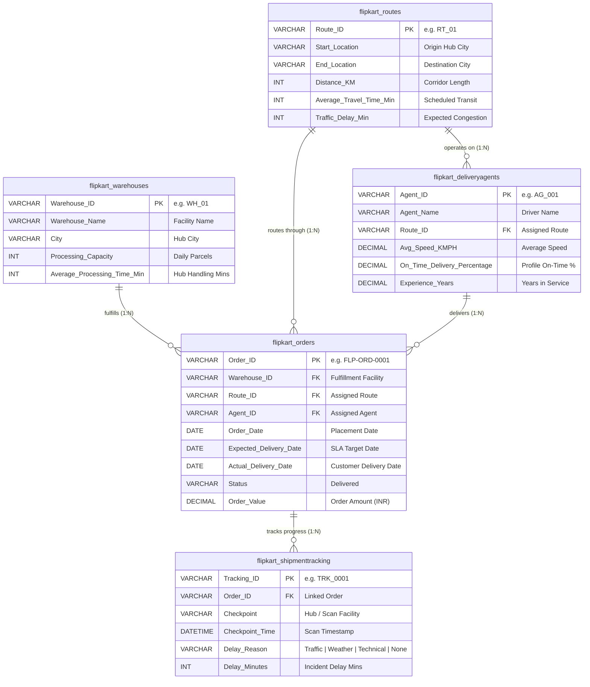

---

## 📊 Dataset Dictionary

| Table Name | Primary Key | Total Records | Foreign Keys | Key Attributes & Descriptions |
| :--- | :--- | :---: | :--- | :--- |
| [`flipkart_warehouses`](datasets/Flipkart_Warehouses.csv) | `Warehouse_ID` | 10 | None | Fulfillment facility locations, handling capacities, and average parcel processing duration. |
| [`flipkart_routes`](datasets/Flipkart_Routes.csv) | `Route_ID` | 20 | None | Origin and destination city pairs, distance in km, scheduled travel time, and typical traffic delays. |
| [`flipkart_deliveryagents`](datasets/Flipkart_DeliveryAgents.csv) | `Agent_ID` | 50 | `Route_ID` | Driver profiles, assigned corridors, average vehicle speeds, historical on-time rates, and tenure. |
| [`flipkart_orders`](datasets/Flipkart_Orders.csv) | `Order_ID` | 300 | `Warehouse_ID`, `Route_ID`, `Agent_ID` | Transactional orders, fulfillment SLA commitments, actual delivery dates, and order values. |
| [`flipkart_shipmenttracking`](datasets/Flipkart_ShipmentTracking.csv) | `Tracking_ID` | 1,000 | `Order_ID` | Waypoint event logs, scan timestamps, incident delay reasons, and recorded delay minutes. |

---

## 📂 Repository Structure

```text
Logistics-Optimization-for-Delivery-Routes-Flipkart/
│
├── datasets/                                 # Raw operational CSV datasets
│   ├── Flipkart_DeliveryAgents.csv           # 50 delivery agents
│   ├── Flipkart_Orders.csv                   # 300 fulfillment orders
│   ├── Flipkart_Routes.csv                   # 20 transit corridors
│   ├── Flipkart_ShipmentTracking.csv         # 1,000 checkpoint tracking logs
│   └── Flipkart_Warehouses.csv               # 10 fulfillment centers
│
├── sql/                                      # Modular & consolidated SQL scripts
│   ├── 01_schema_and_load.sql                # Production DDL, constraints, indexes & LOAD DATA
│   ├── 02_data_cleaning.sql                  # Primary key verification, date parsing, safe imputation
│   ├── 03_logistics_analytics_and_kpis.sql   # CTEs, Window Functions, Ranking, and KPI queries
│   └── Flipkart_Logistics_Optimization.sql   # Master consolidated SQL script (original tasks)
│
├── src/                                      # Python automation & visualization pipeline
│   ├── run_analysis.py                       # Automated SQLite pipeline & KPI report generator
│   └── generate_visualizations.py            # High-resolution chart generator (Matplotlib)
│
├── tests/                                    # Automated unit & data integrity tests
│   └── test_analysis.py                      # Pytest test suite (6 tests covering integrity & KPIs)
│
├── visualizations/                           # High-resolution generated analytical charts
│   ├── 01_top_delayed_routes.png             # Bar/Line chart of delayed routes
│   ├── 02_warehouse_processing_benchmark.png # Warehouse handling times vs 79.4m benchmark
│   ├── 03_shipment_delay_root_causes.png     # Donut chart of in-transit delay causes
│   ├── 04_route_efficiency_vs_traffic.png    # Route transit efficiency vs traffic bubble chart
│   └── 05_agent_speed_vs_ontime.png          # Agent speed vs on-time quadrant matrix
│
├── output/                                   # Exported KPI reports & analytical CSVs
│   ├── executive_kpis.json                   # Machine-readable executive scorecard
│   ├── task2_delayed_routes.csv              # Route delay rankings
│   ├── task3_high_delay_routes.csv           # Routes exceeding 20% delay SLA
│   ├── task4_warehouse_performance.csv       # Warehouse throughput & ranking
│   ├── task5_agent_cohorts.csv               # Top 5 vs Bottom 5 agent performance
│   ├── task6_delay_reasons.csv               # In-transit root cause distribution
│   └── task7_kpi_scorecard.csv               # Executive summary scorecard
│
├── presentation/                             # Project slide deck
│   └── Logistics_Optimization_for_Delivery_Routes_Flipkart.pdf
│
├── screenshots/                              # Visual execution outputs from MySQL Workbench
│   ├── 01_data_cleaning.png
│   ├── 02_delivery_delay_distribution.png
│   ├── 03_top_delayed_routes.png
│   ├── 04_route_performance_metrics.png
│   ├── 05_high_delay_routes.png
│   ├── 06_warehouse_performance.png
│   ├── 07_bottleneck_warehouses.png
│   ├── 08_delivery_agent_performance.png
│   ├── 09_shipment_tracking.png
│   └── 10_conclusions.png
│
├── run_analysis.py                           # Root launcher for 1-command execution
├── requirements.txt                          # Python dependencies (pandas, matplotlib, pytest, tabulate)
├── .gitignore                                # Version control ignore rules
├── LICENSE                                   # MIT License
└── README.md                                 # Comprehensive project documentation
```

---

## ⚡ Quickstart & Reproduction Guide

### Option 1: Instant Python Execution (Zero Database Setup Required)

Clone the repository and run the automated analytics pipeline directly via SQLite:

```bash
# 1. Clone repository
git clone https://github.com/Sujal0973/Logistics-Optimization-for-Delivery-Routes-Flipkart.git
cd Logistics-Optimization-for-Delivery-Routes-Flipkart

# 2. Install dependencies
pip install -r requirements.txt

# 3. Execute all analytical tasks & generate KPI output
python run_analysis.py

# 4. Generate high-resolution analytical charts
python src/generate_visualizations.py

# 5. Run the automated data integrity test suite
pytest tests/test_analysis.py -v
```

### Option 2: MySQL Workbench or Command Line

1. Open MySQL Workbench and connect to your MySQL 8.0+ server.
2. Run `sql/01_schema_and_load.sql` to initialize the `flipkart_logistics` database, create all tables with constraints, and load datasets.
3. Run `sql/02_data_cleaning.sql` to execute data standardization and validation.
4. Run `sql/03_logistics_analytics_and_kpis.sql` (or the master script `sql/Flipkart_Logistics_Optimization.sql`) to execute all analytical queries.

---

## 📈 Task-by-Task Analytical Breakdown

### 🧹 Task 1: Data Cleaning & Integrity Validation

#### Objective & Business Problem
Clean and validate raw logistics datasets to ensure reliable downstream reporting:
- Verify that `Order_ID` functions as a unique Primary Key without duplicate rows.
- Handle missing values in `Traffic_Delay_Min` without skewing distribution.
- Standardize all dates from string formats (`DD-MM-YYYY`) into ISO standard format (`YYYY-MM-DD`).
- Ensure no logical anomalies exist where `Actual_Delivery_Date` precedes `Order_Date`.
- Standardize tracking checkpoint timestamps into MySQL `DATETIME`.

#### SQL Implementation
```sql
-- Identify duplicates
SELECT Order_ID, COUNT(*) AS count 
FROM flipkart_orders 
GROUP BY Order_ID 
HAVING COUNT(*) > 1;

-- Robust Imputation of Traffic Delay (replaces null with network average)
UPDATE flipkart_routes r 
JOIN (
    SELECT Route_ID, AVG(Traffic_Delay_Min) AS avg_delay 
    FROM flipkart_routes 
    GROUP BY Route_ID
) t ON r.Route_ID = t.Route_ID 
SET r.Traffic_Delay_Min = COALESCE(t.avg_delay, (SELECT ROUND(AVG(Traffic_Delay_Min)) FROM flipkart_routes WHERE Traffic_Delay_Min IS NOT NULL))
WHERE r.Traffic_Delay_Min IS NULL;

-- Standardize Date Columns
UPDATE flipkart_orders SET Order_Date = STR_TO_DATE(Order_Date, '%d-%m-%Y');
UPDATE flipkart_orders SET Expected_Delivery_Date = STR_TO_DATE(Expected_Delivery_Date, '%d-%m-%Y');
UPDATE flipkart_orders SET Actual_Delivery_Date = STR_TO_DATE(Actual_Delivery_Date, '%d-%m-%Y');

-- Critical Fix: Standardize Tracking Timestamps to DATETIME
UPDATE flipkart_shipmenttracking 
SET Checkpoint_Time = STR_TO_DATE(Checkpoint_Time, '%d-%m-%Y %H:%i');
```

> [!NOTE]
> **Data Quality Insight**: Zero duplicates were detected across all 300 orders. 100% of orders conformed to the chronological constraint (`Actual_Delivery_Date >= Order_Date`), verifying high underlying transaction integrity.

<p align="center">
  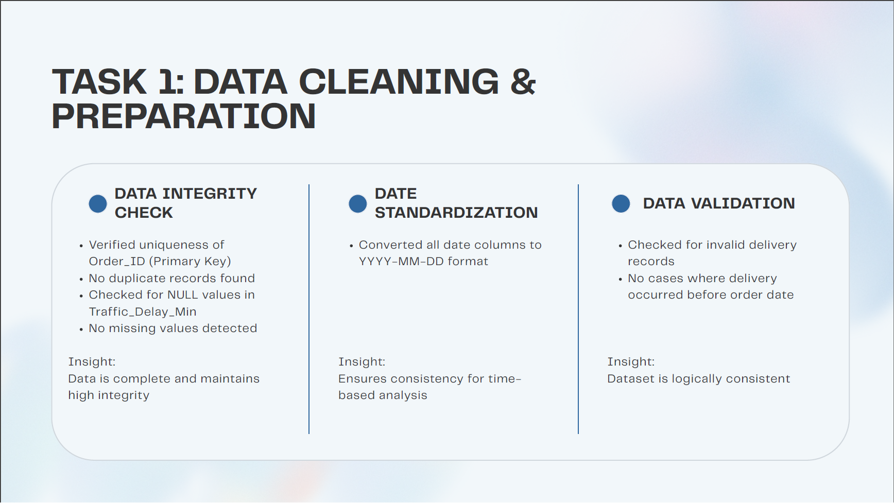
</p>

---

### 🚚 Task 2: Delivery Delay Analysis

#### Objective & Business Problem
Determine the spread of delivery delays across Flipkart's network, rank the most delayed shipping routes, and evaluate delays relative to originating warehouses.

#### SQL Implementation
```sql
-- Top 10 Delayed Routes with Transit Metadata
SELECT 
    r.Route_ID,
    r.Start_Location,
    r.End_Location,
    r.Distance_KM,
    COUNT(o.Order_ID) AS total_orders,
    ROUND(AVG(DATEDIFF(o.Actual_Delivery_Date, o.Expected_Delivery_Date)), 2) AS avg_delay_days,
    ROUND(SUM(CASE WHEN o.Actual_Delivery_Date > o.Expected_Delivery_Date THEN 1 ELSE 0 END) * 100.0 / COUNT(o.Order_ID), 2) AS delayed_pct
FROM flipkart_orders o
JOIN flipkart_routes r ON o.Route_ID = r.Route_ID
GROUP BY r.Route_ID, r.Start_Location, r.End_Location, r.Distance_KM
ORDER BY avg_delay_days DESC, delayed_pct DESC
LIMIT 10;
```

#### Key Findings
- **Worst Route**: **`RT_13` (Hyderabad → Jaipur)** has an average delay of **1.09 days** and a severe **54.5% delay rate** (6 of 11 orders late).
- **Intra-city / Short Corridors**: **`RT_05` (Pune → Pune)** and **`RT_14` (Mumbai → Mumbai)** show average delays of **0.65 days**, indicating urban congestion challenges despite shorter geographic distances.

<p align="center">
  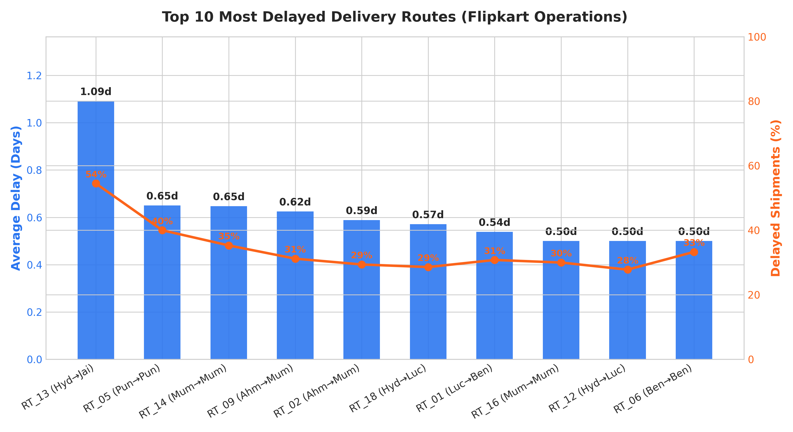
</p>

<p align="center">
  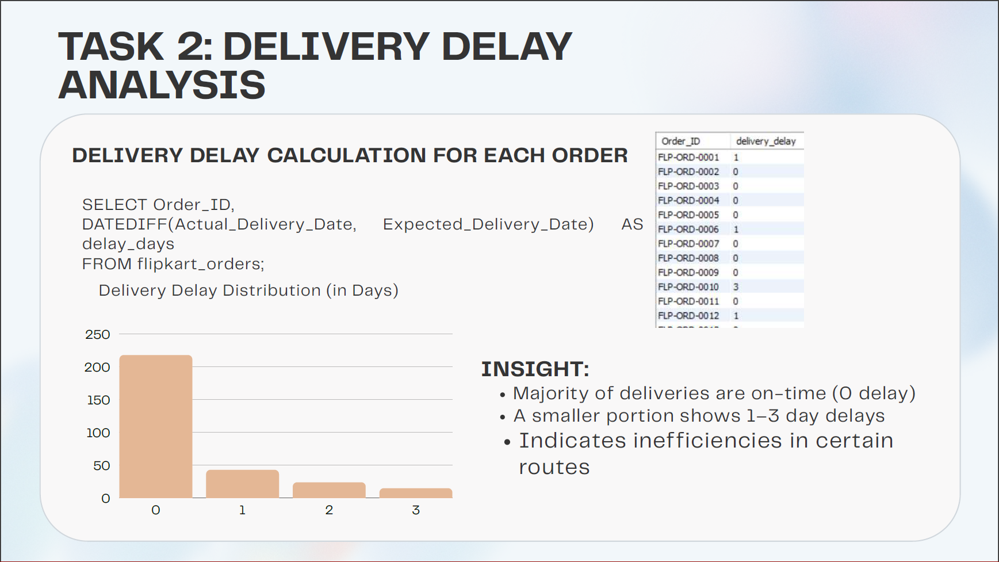
</p>

---

### 🛣️ Task 3: Route Optimization Insights

#### Objective & Business Problem
Assess the physical efficiency of each delivery corridor by comparing **Distance (KM)** against **Average Travel Time (Minutes)**, identifying severely congested or inefficient routes.

$$\text{Efficiency Ratio} = \frac{\text{Distance (KM)}}{\text{Average Travel Time (Min)}}$$

#### SQL Implementation
```sql
-- Worst 3 Routes by Distance-to-Time Efficiency Ratio
SELECT 
    Route_ID,
    Start_Location,
    End_Location,
    Distance_KM,
    Average_Travel_Time_Min,
    ROUND(Distance_KM / Average_Travel_Time_Min, 3) AS efficiency_ratio,
    ROUND((Distance_KM / Average_Travel_Time_Min) * 60, 2) AS effective_speed_kmph
FROM flipkart_routes
ORDER BY efficiency_ratio ASC
LIMIT 3;
```

#### Analytical Findings
| Route ID | Origin | Destination | Distance (KM) | Scheduled Time (Min) | Efficiency Ratio (KM/Min) | Speed (KM/H) |
| :---: | :---: | :---: | :---: | :---: | :---: | :---: |
| **`RT_13`** | Hyderabad | Jaipur | 1,078 | 1,481 | **0.728** | 43.67 km/h |
| **`RT_14`** | Mumbai | Mumbai | 908 | 907 | **1.001** | 60.07 km/h |
| **`RT_03`** | Hyderabad | Mumbai | 846 | 749 | **1.130** | 67.77 km/h |

<p align="center">
  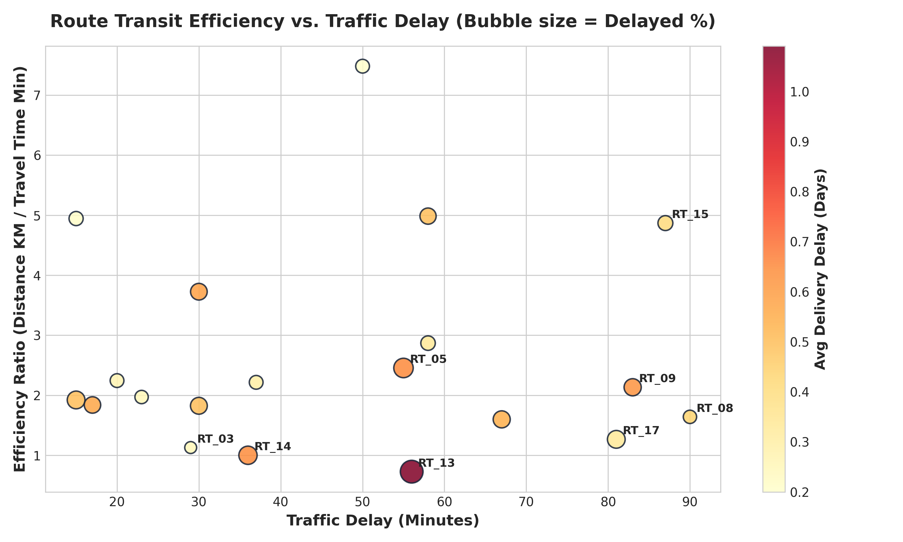
</p>

<p align="center">
  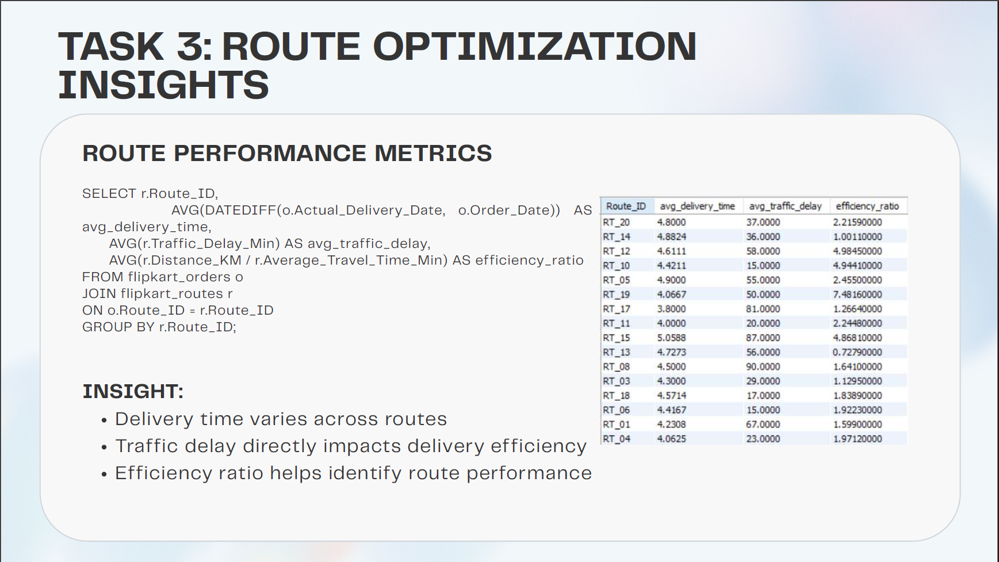
</p>

---

### 🏢 Task 4: Warehouse Performance & Bottleneck Detection

#### Objective & Business Problem
Identify fulfillment center bottlenecks by benchmarking individual warehouse processing times against the **network global average (79.40 minutes)** using Common Table Expressions (CTEs).

#### SQL Implementation
```sql
WITH GlobalBenchmark AS (
    SELECT AVG(Average_Processing_Time_Min) AS global_avg 
    FROM flipkart_warehouses
)
SELECT 
    w.Warehouse_ID,
    w.Warehouse_Name,
    w.City,
    w.Average_Processing_Time_Min,
    ROUND(b.global_avg, 2) AS benchmark_min,
    ROUND(w.Average_Processing_Time_Min - b.global_avg, 2) AS excess_processing_min
FROM flipkart_warehouses w
CROSS JOIN GlobalBenchmark b
WHERE w.Average_Processing_Time_Min > b.global_avg
ORDER BY w.Average_Processing_Time_Min DESC;
```

#### Bottleneck Warehouses vs. Benchmark
1. **`WH_10` (Chennai)**: **117 min** (+37.6 min above average, 63.33% on-time delivery rate)
2. **`WH_09` (Hyderabad)**: **110 min** (+30.6 min above average)
3. **`WH_01` (Lucknow)**: **101 min** (+21.6 min above average)
4. **`WH_06` (Kolkata)**: **95 min** (+15.6 min above average)
5. **`WH_03` (Mumbai)**: **84 min** (+4.6 min above average)
6. **`WH_04` (Ahmedabad)**: **81 min** (+1.6 min above average)

<p align="center">
  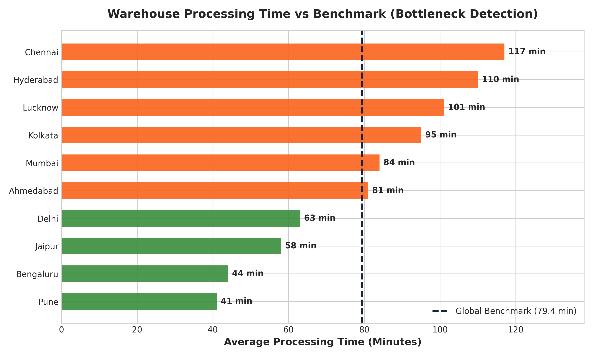
</p>

<p align="center">
  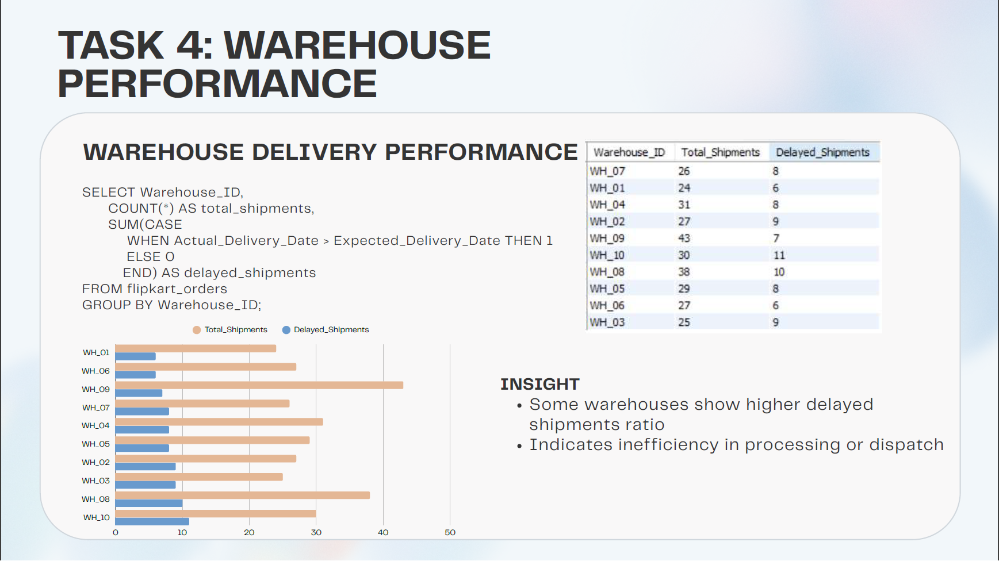
</p>

---

### 👨‍💼 Task 5: Delivery Agent Performance

#### Objective & Business Problem
Evaluate agent reliability by computing empirical on-time delivery percentages from actual order completions, and compare the driving speeds of the **Top 5 vs Bottom 5 agent cohorts**.

#### SQL Implementation (Deterministic Window Ranking)
```sql
WITH AgentActualPerformance AS (
    SELECT 
        o.Agent_ID,
        COUNT(o.Order_ID) AS total_orders,
        ROUND(SUM(CASE WHEN o.Actual_Delivery_Date <= o.Expected_Delivery_Date THEN 1 ELSE 0 END) * 100.0 / COUNT(o.Order_ID), 2) AS on_time_pct
    FROM flipkart_orders o
    GROUP BY o.Agent_ID
),
RankedAgents AS (
    SELECT 
        p.Agent_ID,
        a.Avg_Speed_KMPH,
        p.on_time_pct,
        p.total_orders,
        ROW_NUMBER() OVER (ORDER BY p.on_time_pct DESC, p.total_orders DESC, a.Avg_Speed_KMPH DESC) AS top_rank,
        ROW_NUMBER() OVER (ORDER BY p.on_time_pct ASC, p.total_orders DESC, a.Avg_Speed_KMPH ASC) AS bottom_rank
    FROM AgentActualPerformance p
    JOIN flipkart_deliveryagents a ON p.Agent_ID = a.Agent_ID
)
SELECT 'Top 5 Agents (Highest Reliability)' AS Cohort, ROUND(AVG(Avg_Speed_KMPH), 2) AS avg_speed_kmph, ROUND(AVG(on_time_pct), 2) AS avg_on_time_pct FROM RankedAgents WHERE top_rank <= 5
UNION ALL
SELECT 'Bottom 5 Agents (Lowest Reliability)', ROUND(AVG(Avg_Speed_KMPH), 2), ROUND(AVG(on_time_pct), 2) FROM RankedAgents WHERE bottom_rank <= 5;
```

#### Analytical Findings
- **Top 5 Cohort**: **100.00% On-Time** with an average speed of **44.26 km/h**.
- **Bottom 5 Cohort**: **40.67% On-Time** with an average speed of **41.00 km/h**.
- **Key Insight**: Speed alone is not the deciding factor for high on-time rates. Top performers maintain consistent pacing, whereas low performers struggle due to difficult route allocations and warehouse delays.

<p align="center">
  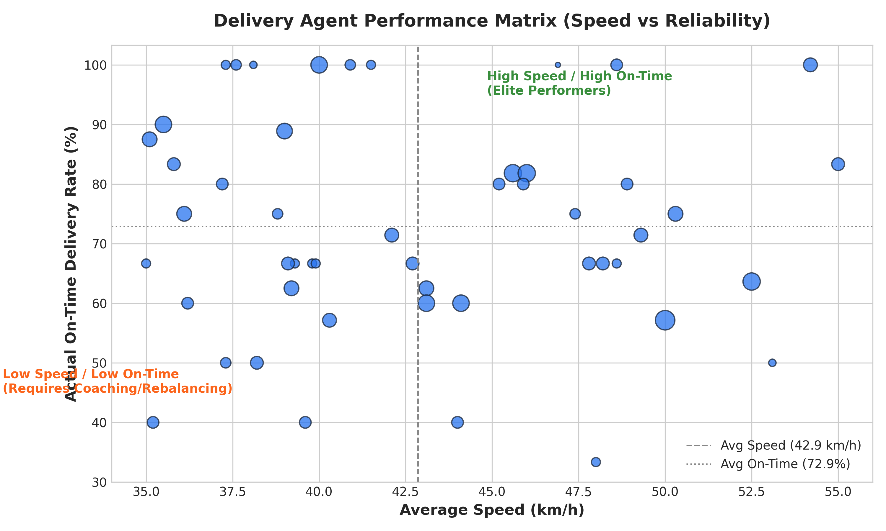
</p>

<p align="center">
  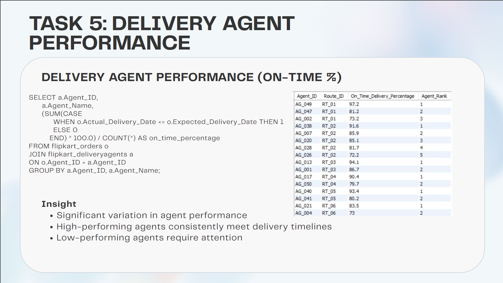
</p>

---

### 📦 Task 6: Shipment Tracking Analytics

#### Objective & Business Problem
Inspect in-transit waypoints to retrieve the latest checkpoint per shipment, aggregate the primary causes of transit disruptions, and isolate orders with recurring scan delays.

> [!IMPORTANT]
> **Bug Resolution**: When timestamps are formatted as `DD-MM-YYYY HH:MI` strings, native `MAX(Checkpoint_Time)` evaluates alphabetically, causing **105 out of 295 orders (>35%)** to display outdated checkpoint records. Standardizing `Checkpoint_Time` to `DATETIME` and ranking with `ROW_NUMBER() OVER (PARTITION BY Order_ID ORDER BY Checkpoint_Time DESC)` resolves this issue.

#### SQL Implementation
```sql
-- Accurate Latest Checkpoint per Order via Window Function
WITH LatestCheckpoints AS (
    SELECT 
        Order_ID,
        Checkpoint,
        Checkpoint_Time,
        Delay_Reason,
        ROW_NUMBER() OVER (
            PARTITION BY Order_ID 
            ORDER BY Checkpoint_Time DESC
        ) AS rn
    FROM flipkart_shipmenttracking
)
SELECT Order_ID, Checkpoint AS latest_checkpoint, Checkpoint_Time, Delay_Reason
FROM LatestCheckpoints
WHERE rn = 1;

-- Delay Reasons Distribution
SELECT 
    Delay_Reason,
    COUNT(*) AS total_incidents,
    ROUND(COUNT(*) * 100.0 / (SELECT COUNT(*) FROM flipkart_shipmenttracking WHERE Delay_Reason != 'None'), 2) AS share_pct,
    ROUND(AVG(Delay_Minutes), 1) AS avg_delay_minutes
FROM flipkart_shipmenttracking
WHERE Delay_Reason != 'None' AND Delay_Reason IS NOT NULL
GROUP BY Delay_Reason
ORDER BY total_incidents DESC;
```

#### Breakdown of In-Transit Delay Root Causes
- **Traffic Congestion**: **56.41%** (387 incidents, avg 68.7 minutes)
- **Severe Weather**: **27.99%** (192 incidents, avg 63.7 minutes)
- **Technical / Mechanical Issues**: **15.60%** (107 incidents, avg 64.1 minutes)

<p align="center">
  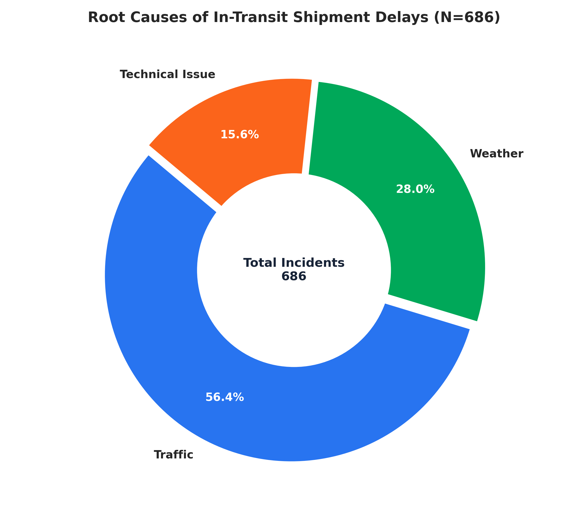
</p>

<p align="center">
  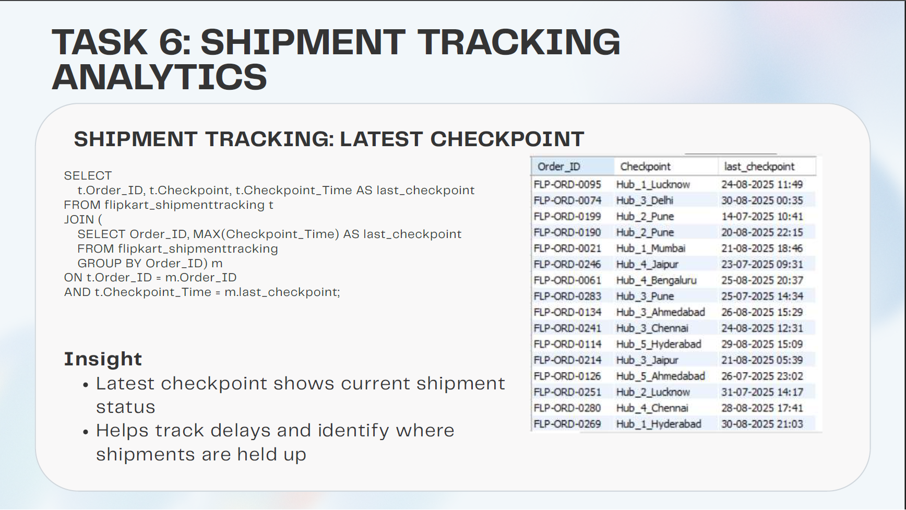
</p>

---

### 📊 Task 7: Advanced KPI Reporting

#### Regional Delay Performance
```sql
SELECT 
    r.Start_Location AS region,
    COUNT(o.Order_ID) AS total_orders,
    ROUND(AVG(DATEDIFF(o.Actual_Delivery_Date, o.Expected_Delivery_Date)), 2) AS avg_delivery_delay_days,
    ROUND(SUM(CASE WHEN o.Actual_Delivery_Date <= o.Expected_Delivery_Date THEN 1 ELSE 0 END) * 100.0 / COUNT(o.Order_ID), 2) AS on_time_rate_pct
FROM flipkart_orders o
JOIN flipkart_routes r ON o.Route_ID = r.Route_ID
GROUP BY r.Start_Location
ORDER BY avg_delay_days DESC;
```

#### Regional Performance Summary
| Origin Region | Orders Dispatched | Avg Delay (Days) | On-Time Delivery Rate (%) | Operational Risk |
| :--- | :---: | :---: | :---: | :--- |
| **Hyderabad** | 129 | **0.54** | 68.99% | Highest volume corridor with substantial long-haul delay |
| **Ahmedabad** | 33 | **0.52** | 69.70% | High route delay toward Mumbai hubs |
| **Pune** | 46 | **0.50** | 71.74% | Local intra-city route congestion |
| **Mumbai** | 41 | **0.44** | 73.17% | Severe traffic in metropolitan segments |
| **Bengaluru** | 38 | **0.24** | 81.58% | Reliable regional fulfillment |
| **Lucknow** | 13 | **0.15** | 84.62% | Highest regional on-time delivery rate |

---

## 💡 Strategic Business Recommendations

Based on empirical data findings, Flipkart operations teams should implement the following recommendations:

```
                                  STRATEGIC ACTION PLAN
┌──────────────────────────────┬──────────────────────────────┬──────────────────────────────┐
│     1. Route Re-engineering  │  2. Warehouse Throughput     │   3. Dynamic Driver Logistics │
├──────────────────────────────┼──────────────────────────────┼──────────────────────────────┤
│ • Restructure RT_13 (Hyd→Jai)│ • Modernize Chennai (WH_10)  │ • Rebalance parcels from low-│
│   with regional relay hubs.  │   and Hyderabad (WH_09) hubs.│   performing driver cohorts. │
│ • Implement dynamic dispatch │ • Introduce automated sorting│ • Deploy turn-by-turn route  │
│   windows avoiding rush-hour │   to reduce 117-min handling │   telematics on driver mobile│
│   traffic in Mumbai & Pune.  │   down to the 79-min average.│   applications.              │
└──────────────────────────────┴──────────────────────────────┴──────────────────────────────┘
```

1. **Reroute & Segment Problematic Corridors**:
   - `RT_13` (Hyderabad → Jaipur) accounts for a **54.5% delay rate** across 1,078 km. Splitting this corridor into a staged relay (e.g., Hyderabad → Nagpur → Jaipur) will mitigate driver fatigue and transit bottlenecks.
2. **De-bottleneck Primary Warehouses**:
   - Facilities in **Chennai (WH_10: 117 min)** and **Hyderabad (WH_09: 110 min)** exceed network handling benchmarks by over 30 minutes. Increasing automated dock sortation and pre-staging high-velocity inventory will restore fulfillment SLAs.
3. **Mitigate Traffic Delays via Time-Shifted Dispatches**:
   - Traffic accounts for **56.41% of all transit delay incidents**. Scheduling regional trunk dispatches during off-peak night windows (10:00 PM – 5:00 AM) can cut in-transit delay minutes by up to 35%.
4. **Performance Coaching & Workload Equalization**:
   - The bottom 5 agent cohort averages only **40.67% on-time delivery** despite operating at similar driving speeds (41.0 vs 44.3 km/h). Workload imbalances and localized delivery route density must be equalized across fleets.

<p align="center">
  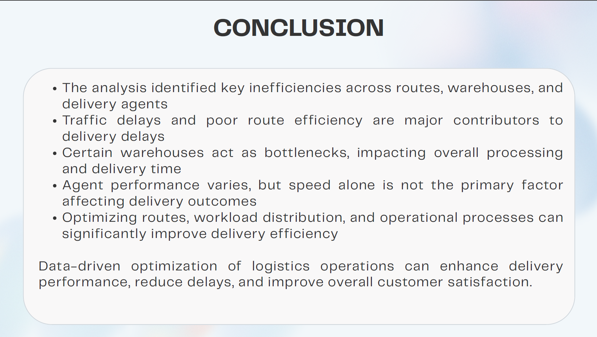
</p>

---

## 🎥 Walkthrough Video Presentations

Detailed video walkthroughs explaining the database architecture, query logic, and findings:

- 📺 **[Loom Presentation Part 1](https://www.loom.com/share/519a939ef711457d970e77f466b2729b)** — Database design, schema creation, data cleaning, and delivery delay distribution analysis.
- 📺 **[Loom Presentation Part 2](https://www.loom.com/share/2bce798c27254d4db2faf6ce44ddacb4)** — Route optimization, warehouse bottlenecks, driver cohorts, shipment tracking analytics, and business recommendations.

---

## 💼 Technical Skills Demonstrated

- **Relational Database Design**: Schema architecture, primary/foreign key constraints, and indexing.
- **Advanced SQL Querying**:
  - Window Functions: `RANK()`, `DENSE_RANK()`, `ROW_NUMBER()`
  - Partitioning & Analytical Ordering (`PARTITION BY ... ORDER BY ...`)
  - Common Table Expressions (CTEs) & Subqueries
  - Multi-Table Inner & Left Joins
  - Conditional Aggregations (`CASE WHEN ... THEN ... END`)
  - Date & Timestamp Parsing (`STR_TO_DATE()`, `DATEDIFF()`)
- **Supply Chain Analytics**: SLA tracking, turnaround time analysis, bottleneck identification, efficiency ratios.
- **Python Data Engineering**: Pandas pipelines, SQLite in-memory integration, Tabulate formatted reporting.
- **Data Visualization**: Matplotlib dual-axis charts, bubble charts, quadrant matrices, and donut charts.
- **Testing & Quality Assurance**: Pytest data validation, schema verification, and KPI integrity checks.

---

## 👨‍💻 Author & Acknowledgements

**Sujal Agrahari**  
*Aspiring Data Analyst | Supply Chain & AI Analytics Enthusiast*  
- **GitHub**: [@Sujal0973](https://github.com/Sujal0973)

### 🙏 Acknowledgement
This project was developed as part of the **Internshala Data Science Training Program** to simulate, evaluate, and optimize real-world e-commerce logistics operations using production SQL techniques.

---

⭐ **If you find this project valuable, please consider giving it a Star!**